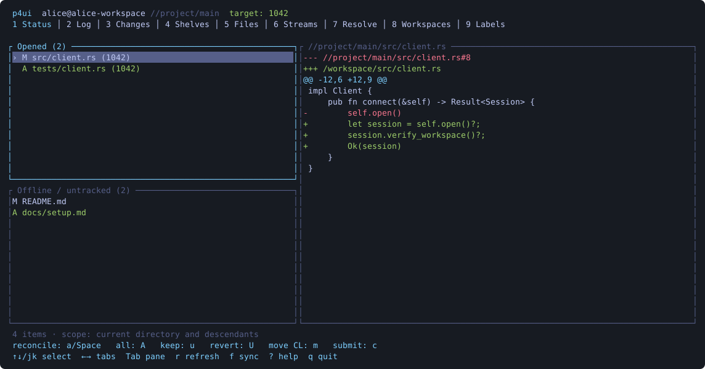

# p4ui

A keyboard-driven terminal interface for Perforce, inspired by [gitui](https://github.com/gitui-org/gitui). It brings a familiar tab bar, two status lists, a colored diff pane, contextual commands, and keyboard navigation to Perforce workspaces.



**Status: early release.** The core workflows have real `p4`/`p4d` integration tests, including conflicting edits and stream integration. This is a new application, not a claim of gitui's maturity or complete feature parity. See [feature mapping and remaining gaps](docs/PARITY.md) and [validation](docs/TESTING.md).

## Install and run

Requirements: Rust 1.88 or newer, the Perforce `p4` client supporting tagged JSON (`-ztag -Mj`), and an existing workspace. Development is tested locally with P4/P4D 2026.1 on macOS ARM64. A daemon is only needed to run the server integration tests; it is not bundled or started during normal use.

```sh
cargo install --path . --locked
cd /path/to/your/perforce/workspace
p4 login                   # if required by your server
p4ui
```

Or run directly:

```sh
cargo run --release -- -d /path/to/workspace
p4ui -p ssl:perforce.example.com:1666 -u alice -c alice-workspace
p4ui --check               # connection/workspace diagnostics
p4ui --status              # machine-readable workspace status, no TTY needed
p4ui --log                 # one history page as JSON; no workspace scan
p4ui --tab log             # open directly in Log without loading Status
p4ui --max-p4-processes 2   # cap concurrent p4 commands; default is 4
p4ui --help
```

Set `P4PORT` to connect without a port flag:

```sh
export P4PORT=ssl:perforce.example.com:1666
p4ui -u alice -c alice-workspace
# Or just for this invocation:
P4PORT=perforce.example.com:1666 p4ui --check
```

For the server address, p4ui uses `--port` / `-p` first, then a nonempty `P4PORT`, then the normal `p4` configuration (including `P4CONFIG` / `P4ENVIRO`). The chosen flag or environment address overrides a server address in a workspace config file. Other settings such as `P4USER`, `P4CLIENT`, `P4CHARSET`, trust, ignore rules, and login tickets continue to use normal `p4` resolution. Explicit connection flags override their corresponding settings. Authentication/SSO, trust enrollment, server administration, and workspace creation remain in the `p4` CLI. No passwords are accepted on p4ui's command line or stored in its configuration.

`--max-p4-processes N` limits concurrent P4 commands per p4ui instance. The default is **4**; use **1** for serial requests or **2** to reduce concurrency. Independent read-only requests run in parallel, including Status queries and the initial history/connection lookup. Mutations remain serialized, and older history pages follow their cursor order.

Run from the workspace root to operate on the whole workspace. Status, history, Files, and bulk sync/reconcile/merge/copy use the current directory and its descendants. **Submit and shelve operate on the entire changelist**, including files outside that directory. Enter on a pending changelist shows its complete file list across the workspace. Selected-file actions apply to that file, even outside the current directory.

Selecting a workspace keeps the current server, user, and character set for the session. A `P4CONFIG` file in the selected workspace cannot redirect that connection. To connect to a different server or user, start another p4ui instance with the desired settings.

## Build and native packages

See [Building on macOS and Linux](docs/BUILDING.md) for Apple Silicon/Intel Mac instructions, distro build prerequisites, and `.deb`, `.rpm`, and Arch package recipes. Branch builds upload downloadable artifacts to [GitHub Actions](https://github.com/adamflott/p4ui/actions/workflows/packages.yml). Pushing an ordinary stable `vX.Y.Z` tag automatically publishes all packages under [Releases](https://github.com/adamflott/p4ui/releases) after the package and full CI checks pass. Command-managed tags prepare drafts for final verification. See [Releasing](docs/RELEASING.md) for version updates and existing-tag releases. These are upstream packages; availability in official distro repositories is tracked separately.

Maintainers can prepare and publish a new stable version with one command:

```sh
./scripts/release.py 0.3.1
```

Run from a clean, synchronized default branch after pushing source changes. The command updates version metadata and release notes, runs local and GitHub checks, verifies package checksums, and publishes only after all checks pass. See [Releasing](docs/RELEASING.md) for prerequisites, `--check`, and `--resume`.

## Workflow

1. In **Status**, select an offline/untracked file and press `Space` or `a` to reconcile it. `A` reconciles all files in scope after confirmation. `p4 ignore` rules are honored through the client's usual configuration.
2. For tracked files, use **Files**, press `e` to open for edit, or `o` to open for edit and launch your editor. Editor selection is `P4EDITOR`, `VISUAL`, `EDITOR`, then `vi` (`notepad` on Windows). Commands with quoted arguments are supported; shell pipelines/expansion are not evaluated.
3. In **Changes**, press `n` to create a numbered changelist. Select it and press `Space` to make it the target for subsequent file actions. In Status, `m` moves an opened file to a chosen changelist.
4. Press `c` to submit. The default changelist asks for a description; numbered changelists use their saved description (`E` edits it). Multiline inputs use Enter for a newline and **Ctrl-S** to accept. All submissions require explicit `y` confirmation.
5. Use **Log** to inspect submitted change summaries. Enter drills into the first 200 affected files; select a file for its revision-specific diff. `Esc` returns. Shelves and pending changes support the same drilldown.
6. `s` in Changes shelves a numbered changelist. Shelving keeps the files open; revert separately when ready. `u` in Shelves unshelves into a chosen pending change. Existing shelf content is never force-overwritten.
7. `f` syncs to depot HEAD after confirmation. **Resolve** lists unresolved files; `R` chooses safe automatic resolve, merge, yours, or theirs. Conflicts left by auto resolve require your merge tool and `p4 resolve`.

Nonfatal workspace scan warnings appear in the status bar; press `?` to read their full messages. Usable files remain available, and warnings identify potentially incomplete results. Authentication errors and failed commands still stop the request.

The result of a failed submit can be a newly numbered pending changelist. Refresh and inspect Changes before retrying. Timeouts and interrupted network operations also require inspection; server changes are not assumed to be rolled back.

## Keys

`?` / F1 opens full help, including the keys for the current workflows. Arrow keys and `j`/`k` navigate; left/right or `1`–`9` switch tabs; Tab focuses the diff pane. PageUp/PageDown and Home/End scroll. `/` filters **loaded** rows, scrolling near the bottom loads an older page in Log/Shelves (`+` also loads a page; it increases the result limit in other tabs), `r` / F5 refreshes, and `q` exits. Read-only background requests are cancelled on exit; p4ui waits for active mutations before allowing a normal exit.

On Status, press **`t`** to jump directly between **Opened** and **Offline / untracked**, selecting the first matching file in the destination pane. This works from the diff pane too and respects the active filter; an empty destination keeps the selection and shows a message. You can also use Down/`j` past the last Opened file or Up/`k` across the boundary. Tab toggles focus between the file lists and diff. End selects the last file. Returning to Status restores its selected file, filter and pane scroll positions after refreshing; workspace changes reset them.

File badges show Perforce actions: `A` is add/branch/move destination, `M` is edit/modify (and the fallback for other actions), and `D` is delete/move source. For unopened files, Files shows the last submitted revision's action, so these badges can describe depot history. Status shows pending workspace changes.

Press `C` on any tab to edit the **current workspace's client specification** in your configured editor (`P4EDITOR`, `VISUAL`, `EDITOR`, then `vi`/`notepad`). Save and exit the editor, then press `y` to save the specification to Perforce, or `n`/Esc to discard it. An unchanged form is not saved. The `Client:` name must stay unchanged. Editing the spec does not sync files or change p4ui's working directory. If the editor or save fails, the error shows a recovery draft path.

| Tab | Commands |
| --- | --- |
| Status | `t` jump between Opened and Offline / untracked; `a` / Space reconcile or reopen to target; `A` reconcile all; `o` editor; `m` move to changelist; `u` metadata revert, keep content; `U` discard/revert |
| Log | Enter browse files; `b` annotate revision; `h` file/integration history |
| Changes | `n` new; Space target; Enter files; `E` edit description; `s` shelve; `c` submit; `D` delete empty change |
| Shelves | Enter files; `u` unshelve; `D` delete shelf |
| Files | `e` open for edit; `o` editor; `b` annotate; `h` history; `v` inspect revision; `D` open for delete; `M` move; `L` lock / `l` unlock |
| Streams | `o` / Space switch; `n` create; `D` delete spec; `g` merge from selected; `p` copy from selected |
| Resolve | `R` resolve (`-am`, `-as`, `-ay`, `-at`) |
| Workspaces | `o` / Space select local workspace for this session; `C` edit current client spec (available on every tab) |
| Labels | Inspect label specifications and filter the list |

`U`, delete, sync, submit, unshelve, integration, and switching require confirmation. Enter never accepts a destructive confirmation: press `y` explicitly.

Stream commands require a stream workspace and follow server flow/permission rules. Creation makes a development child of the **current** stream, or a mainline when no current stream is set; a stream depot must already exist. Creating the specification does not populate files. Switch to it, select the parent, merge (`g`) to populate a development stream, resolve, inspect, and submit. Copy (`p`) promotes development to its parent after incoming changes have been merged. Stream deletion removes the specification, not submitted history. Stream paths cannot be renamed as though they were Git branch references.

## Configuration

The default path is `$XDG_CONFIG_HOME/p4ui/config.toml` or `~/.config/p4ui/config.toml`; on Windows, `%APPDATA%/p4ui/config.toml`. Use `--config path` to override. Missing default configuration is fine; unknown fields, unsupported themes, and conflicting key bindings are errors.

```toml
refresh_seconds = 10          # 0 disables automatic refresh; Log/Shelves refresh manually
command_timeout_seconds = 120 # 1..3600, including submits and large syncs
max_output_mb = 16            # 1..256 per command/preview
page_size = 200               # non-history tabs: 10..10000; + raises it
history_page_size = 100       # 1..200 maximum batch; interactive batches use visible rows
history_max_scan_rows = 0     # inherit server limits; 1..1000000 requests a stricter cap
theme = "dark"               # dark, light, mono

[keys]
quit = "Q"
# Single characters; arrow/navigation keys remain available.
```

Configurable action names: `quit`, `refresh`, `help`, `search`, `up`, `down`, `open`, `reconcile`, `submit`, `sync`, `new_change`, `revert`, `edit`, `shelve`, `unshelve`, `delete`, `move_change`, `annotate`, `filelog`, `resolve`, `rename`, `lock`, `revision`, `edit_change`, `edit_client`, `status_pane`. Fixed keys are Space, `A`, `g`, `p`, `l`, `+`, digits and terminal navigation keys. Swapping two bindings requires configuring both.

## History on large depots

Log and Shelves initially request enough actual changes to fill the visible list, up to `history_page_size` per request. Moving down near the bottom (arrow keys, PageDown, or mouse wheel) fetches the next page in the background. `+` also loads an older page. Resizing a larger terminal fills its additional rows. Pages append to the cache, preserving selection; older pages use the changelist immediately before the oldest returned change as their upper bound. Gaps in changelist numbers do not reduce the number of changes requested.

Log pages use `p4 changes -L -m N -s submitted ...`, with an upper revision bound for older pages. There are no file-head scans, global-counter walks, or repeated queries for already cached Log pages. Perforce ignores revision bounds on file-scoped shelf listings, so Shelves use `-s shelved`, refetch a bounded prefix (at most 10,000 rows), and filter with an ID cursor to handle shelf insertions/deletions. Connection information is reused within a browsing session. Switching tabs cancels an outstanding background read; active mutations continue to completion. Log and Shelves never poll while idle. `r` refreshes from the newest changes. Filters search the cached rows only; at most 10,000 changes are cached.

By default, p4ui inherits the server's resource limits, just like the P4 CLI. `history_max_scan_rows = 0` does not override them. A positive value requests an optional stricter scan cap, clamped to reported group limits; if group metadata cannot be read completely, p4ui leaves the server limits unchanged and warns. Such overrides can be ignored by a server configured with `server.commandlimits=2`. `-m N` limits returned changes, not necessarily scanned database rows, so a large scope can still exceed an admin limit. See Perforce's [query limit documentation](https://help.perforce.com/helix-core/server-apps/p4sag/current/Content/P4SAG/performance.prevention.query_limits.html).

On a failed request, automatic paging pauses and existing rows/cursors are retained. There is no automatic retry or silent skipping of changes. Narrow the launch directory if the server limit was reached; `r` refreshes or `+` explicitly retries an older page. Automatic change previews omit diffs and show at most 200 files. Enter opens per-file diffs.

If you copied an older configuration example with `history_max_scan_rows = 50000`, set it to `0` to use normal server limits. The old `history_change_window` configuration key remains accepted for compatibility and no longer affects paging.

For read-only diagnostics, `p4ui --log` emits one result-count-limited page as JSON, including `history.next`, optional scan limits and warnings. `p4ui --log --before-change 12345` starts at an inclusive upper changelist bound.

## Development

```sh
cargo fmt --all -- --check
cargo clippy --locked --all-targets -- -D warnings
cargo test --locked
cargo test --locked --test perforce -- --ignored
cargo build --locked
python3 tests/ui_smoke.py
python3 tests/history_ui.py
```

Integration fixtures use isolated temporary servers via the local `rsh:` transport. They do not connect to your server or listen on a network port. Their security overrides apply **only to their temporary databases**, which are deleted after each test. Python 3 is needed for process-boundary tests and the Unix PTY smoke test. See [CONTRIBUTING.md](CONTRIBUTING.md).

## License and credit

MIT. The interface and workflow are inspired by gitui; this implementation is original Rust code using Ratatui and Crossterm, rather than a fork of gitui's Git backend. Perforce, P4, and gitui belong to their respective owners. This is an independent project.
